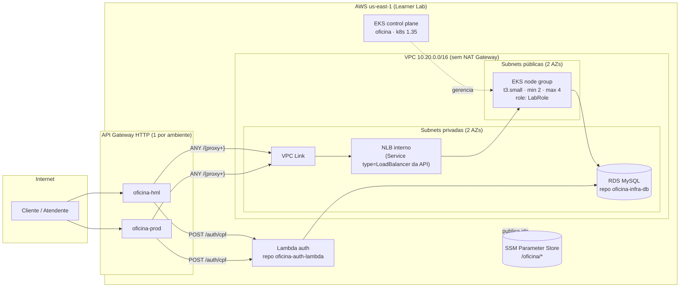

# oficina-infra-k8s — Infraestrutura Kubernetes (Terraform)

Repositório **2 de 4** do Tech Challenge FIAP SOAT (Fase 3). Provisiona, na **AWS Academy
(Learner Lab)**, a rede, o cluster Kubernetes gerenciado (EKS) com escalabilidade e o
**API Gateway** que é a entrada única do sistema da oficina mecânica.

| Repositório | Papel |
| --- | --- |
| [oficina-auth-lambda](https://github.com/Fabio-GST/oficina-auth-lambda) | Function Serverless de autenticação por CPF (emite o JWT) |
| **oficina-infra-k8s** (este) | VPC, EKS, namespaces por ambiente, API Gateway, parâmetros no SSM |
| [oficina-infra-db](https://github.com/Fabio-GST/oficina-infra-db) | Banco gerenciado (RDS MySQL) e modelo de dados |
| [oficina-api](https://github.com/Fabio-GST/oficina-api) | Aplicação principal (AdonisJS) executando no EKS — [Swagger/OpenAPI](https://github.com/Fabio-GST/oficina-api/blob/main/docs/openapi.json) |

## Arquitetura deste repositório



Dentro do cluster, este repositório cria:

| Recurso | Para quê |
| --- | --- |
| Namespaces `oficina-hml` e `oficina-prod` + `ResourceQuota` | Um cluster, dois ambientes isolados (economia de crédito) |
| `metrics-server` (Helm) | Métricas de CPU/memória para o **HPA** da aplicação |
| `cluster-autoscaler` (Helm, opcional) | Escala o node group entre `nos_minimo` e `nos_maximo` |
| Add-ons `coredns`, `kube-proxy`, `vpc-cni` | Base do EKS |

## Tecnologias

- **Terraform** ≥ 1.5 — providers `aws` 5.x, `kubernetes` 2.x, `helm` 2.x
- Módulos `terraform-aws-modules/vpc` 5.x e `terraform-aws-modules/eks` 20.x
- **Amazon EKS** 1.35, **API Gateway HTTP API** + VPC Link, **SSM Parameter Store**
- **GitHub Actions** (CI com `fmt`/`validate`/`tflint`/`plan` comentado no PR; CD com `apply`)
- Estado remoto em **S3 + DynamoDB**

## Adaptações ao AWS Academy Learner Lab

| Limitação do lab | O que foi feito |
| --- | --- |
| Não cria roles/policies IAM nem OIDC provider | Cluster, node group e Lambda usam a **`LabRole`** existente (`create_iam_role = false`). Nada de IRSA: o Cluster Autoscaler usa as permissões da role dos nós. |
| Credenciais temporárias, expiram a cada sessão | Pipelines usam `AWS_ACCESS_KEY_ID` / `AWS_SECRET_ACCESS_KEY` / `AWS_SESSION_TOKEN` como secrets; o script [`scripts/atualizar-credenciais-aws.sh`](./scripts/atualizar-credenciais-aws.sh) os renova nos 4 repos. |
| Crédito limitado (~US$ 50–100) | Sem NAT Gateway (nós em subnets públicas), 2 × `t3.small`, 1 cluster com 2 namespaces, sem KMS/log group do control plane. **Destrua ao fim da sessão.** |
| Região | `us-east-1` fixa. |

Custo aproximado com tudo de pé: EKS US$ 0,10/h + 2 nós US$ 0,04/h + NLB US$ 0,02/h ≈ **US$ 0,17/h**.

## Como executar

### 1. Uma única vez: backend do state

Com o lab iniciado e as credenciais no terminal:

```bash
aws s3api create-bucket --bucket oficina-terraform-state-SEUSUFIXO --region us-east-1
aws s3api put-bucket-versioning --bucket oficina-terraform-state-SEUSUFIXO --versioning-configuration Status=Enabled
aws dynamodb create-table --table-name oficina-terraform-lock \
  --attribute-definitions AttributeName=LockID,AttributeType=S \
  --key-schema AttributeName=LockID,KeyType=HASH --billing-mode PAY_PER_REQUEST
```

Defina nos 4 repositórios as **variáveis** `TF_STATE_BUCKET` e `TF_LOCK_TABLE` (Settings →
Secrets and variables → Actions → Variables).

### 2. A cada sessão do lab: renovar credenciais

```bash
./scripts/atualizar-credenciais-aws.sh
```

O script lê `~/.aws/credentials` (perfil `default`, colado do painel "AWS Details" do lab) e
atualiza os secrets dos 4 repositórios com o `gh` CLI.

### 3. Aplicar localmente

```bash
cd terraform
cp backend.hcl.example backend.hcl        # ajuste o bucket
cp terraform.tfvars.example terraform.tfvars
terraform init -backend-config=backend.hcl
terraform plan
terraform apply
```

Depois do apply (~15 min, o EKS é lento):

```bash
aws eks update-kubeconfig --region us-east-1 --name oficina
kubectl get nodes
kubectl -n kube-system get deploy metrics-server
kubectl get ns oficina-hml oficina-prod
```

### 4. Habilitar o API Gateway

O gateway aponta para o NLB que o `Service` da API cria. Portanto, a ordem é:

1. `terraform apply` aqui com `habilitar_gateway = false` (padrão);
2. deploy da aplicação pelo repo **oficina-api** (cria o NLB em cada namespace);
3. aqui, `terraform apply -var habilitar_gateway=true` — ou setar a variável
   `HABILITAR_GATEWAY=true` no repositório para o CD fazer isso.

A URL de cada ambiente sai em `terraform output gateway_urls` e em
`/oficina/<amb>/gateway/url` no SSM.

### 5. Fim da sessão

```bash
terraform destroy
```

ou pelo GitHub: **Actions → CD → Run workflow → destruir = true**.

## Deploy automático (CI/CD)

| Evento | Workflow | O que faz |
| --- | --- | --- |
| Pull request para `homolog`/`main` | [`ci.yml`](./.github/workflows/ci.yml) | `terraform fmt`, `validate`, `tflint` e `plan` (comentado no PR) |
| Push em `homolog` | [`cd.yml`](./.github/workflows/cd.yml) | `terraform apply` no environment **hml** |
| Push em `main` | [`cd.yml`](./.github/workflows/cd.yml) | `terraform apply` no environment **prod** |

A infraestrutura é compartilhada pelos dois ambientes (namespaces no mesmo cluster), então os
dois pipelines aplicam o mesmo state de forma serializada; a diferença é o environment do
GitHub, que pode exigir aprovação manual em `prod`. `main` e `homolog` são protegidas:
sem commit direto, merge apenas por pull request.

## Contrato com os outros repositórios (SSM)

| Parâmetro | Consumido por |
| --- | --- |
| `/oficina/vpc/id`, `/oficina/vpc/subnets-privadas`, `/oficina/vpc/subnets-publicas`, `/oficina/vpc/cidr` | oficina-infra-db, oficina-auth-lambda |
| `/oficina/eks/nome`, `/oficina/eks/sg-nos` | oficina-api (kubeconfig), oficina-infra-db (libera 3306 para os nós) |
| `/oficina/<amb>/namespace` | oficina-api |
| `/oficina/<amb>/gateway/id`, `/oficina/<amb>/gateway/url` | oficina-auth-lambda (adiciona a rota `/auth/cpf`), oficina-api (smoke test) |
| `/oficina/iam/lab-role-arn` | oficina-auth-lambda |

## Decisões registradas

- Um cluster com namespaces por ambiente, sem NAT Gateway e sem IRSA — consequências diretas
  do crédito e das restrições de IAM do Learner Lab (RFC "escolha da nuvem" no repo
  oficina-api).
- API Gateway HTTP API com VPC Link em vez de Ingress/ALB: o AWS Load Balancer Controller
  exige IRSA; o NLB nativo do `Service` dispensa controladores extras.
- HPA (na aplicação) + Cluster Autoscaler (aqui) cobrem escalabilidade de pods e de nós.
